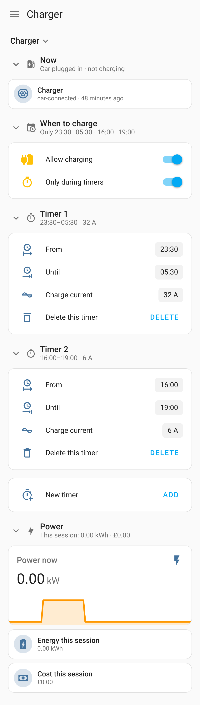
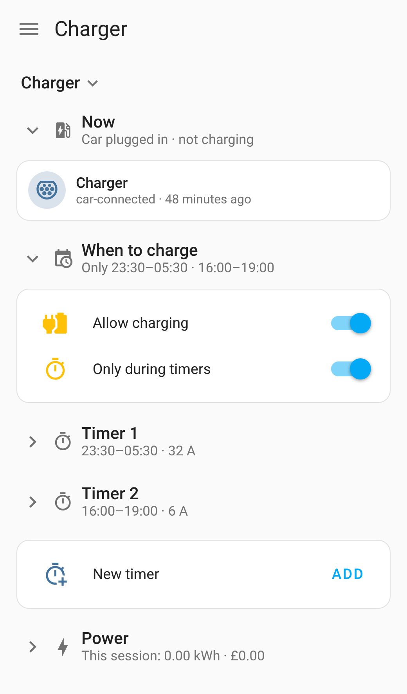
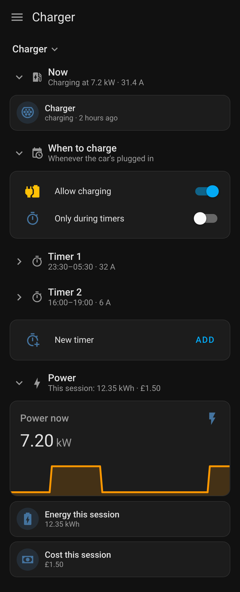

# EO-Lite

[](https://github.com/Picardas/EO-Lite/actions/workflows/validate.yml)
[](https://hacs.xyz/docs/faq/custom_repositories/)
[](https://www.home-assistant.io/)

**Charging toggles that mean what they say, and a Charger dashboard, for an
OpenEO charger that's already in Home Assistant.** EO-Lite gives you:
- **Allow charging**: off means the car never charges, timers included.
- **Only during timers**: with charging allowed, the car charges only in the
  charger's timers.
- A **Charger dashboard** that builds itself, with each of the charger's
  timers in a block that folds away.

It sits on top of the charger's own integration and uses its entities. It
doesn't talk to the charger itself.

|  |  |  |
| :---: | :---: | :---: |
| Now, when to charge, each timer, power | Fold what you don't need: the headings still tell you | Charging, in the dark theme |

<sub>The screenshots show the Charger dashboard with a sample charger.</sub>

> [!NOTE]
> **EO-Lite is vibe-coded.** It was built by prompting an AI coding
> assistant (Claude Code), not written by hand. It has a test suite that
> runs on every change, against a stand-in charger. **It hasn't been tried
> on a real charger yet.**

## Installation

EO-Lite needs Home Assistant 2026.10 or later, and the OpenEO charger's own
integration set up first.

**With [HACS](https://hacs.xyz)** (recommended):
1. In HACS, open ⋮ → **Custom repositories**.
2. Add `https://github.com/Picardas/EO-Lite` as an **Integration**.
3. Download **EO-Lite**, then restart Home Assistant.

**By hand:** copy `custom_components/eo_lite` into your configuration's
`custom_components/` folder, then restart Home Assistant.

Then go to **Settings → Devices & services → Add integration → EO-Lite**.
- It asks two things: which charger, and whether to add its Charger
  dashboard.
- Reload the browser, and the Charger dashboard is in the sidebar.

Setting it up changes nothing on the charger by itself: the two toggles
start as the charger is.

## Allow charging, and Only during timers

The charger's own two switches each allow charging by themselves:
`switch.openeo_charger_charging` charges straight away, and
`switch.openeo_charger_timers` charges during the timers even with the first
one off. EO-Lite's toggles are two switches of its own, and it sets the
charger's from them:

| Allow charging | Only during timers | The car charges | Charging switch | Timers switch |
| -------------- | ------------------ | --------------- | --------------- | ------------- |
| off | off or on | never | off | off |
| on | off | whenever it's plugged in | on | off |
| on | on | only during the timers | off | on |

- **Only during timers is remembered** while charging isn't allowed, so
  allowing it again doesn't start charging straight away.
- **The toggles are in charge.** EO-Lite sets the charger again when Home
  Assistant starts and when the charger comes back after being unreachable.
  Use the toggles, on the dashboard or in automations
  (`switch.eo_lite_allow_charging`, `switch.eo_lite_only_during_timers`),
  rather than the charger's own switches: a change made to those somewhere
  else is left alone and isn't shown on the toggles.

## The Charger dashboard

One card, **Charger**, of blocks that each fold away (tap a heading; tap
**Charger** to fold them all). Each heading sums its block up, so a folded
one still tells you what you need. Which blocks are folded is each person's
own.

- **Now**: what the charger's doing.
- **When to charge**: Allow charging, with Only during timers under it while
  that's on.
- **Timer 1, 2, …**: one block for each timer, with its times and its own
  charge current (a low one for slow charging at peak times, say) and a
  button to delete it. **New timer** adds one while the charger has a slot
  free.
- **Power**: power now, and this session's energy and cost.

The dashboard is a strategy, so it's built each time it loads. To add it to
a dashboard of your own:

```yaml
strategy:
  type: custom:eo-lite
```

## Limitations

- **The timers are the charger's.** EO-Lite shows as many as the charger's
  integration has slots for (`number.openeo_charger_charge_schedule_<n>_current`
  and the entities beside it). More than that needs a change to that
  integration.
- **The charger's overall current limit** isn't on the dashboard. Charging
  outside the timers uses it as it's set on the charger.
- **One charger.**
- **The charger's entity ids** must start as its integration names them
  (`switch.openeo_charger_charging`, `sensor.openeo_charger_power_delivered`
  and so on). EO-Lite finds the rest from the charging switch's.

## Development

```bash
pip install -r requirements_test.txt
pytest                             # the toggles and setup, against a stand-in charger
npm install --no-save jsdom
node tests/dashboard.test.js       # the dashboard script, in a stand-in browser
```

[AGENTS.md](AGENTS.md) explains how the code is laid out and how to change
it. `docs/dashboard-before-eo-lite.yaml` is the hand-written dashboard this
replaced.

EO-Lite isn't affiliated with or endorsed by EO Charging or the OpenEO
project.
